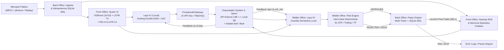

# Arquitectura Técnica y Agentes (Quant Multi-Agent Trader)

Este documento describe en profundidad la arquitectura interna, modelos matemáticos, contratos de datos, flujo de retroalimentación y esquema de persistencia del sistema **Quant Multi-Agent Trader**.

---

## 1. Diagrama del Ciclo de Decisión Multi-Agente

---

## 2. Capas del Sistema y Contratos

### 2.1 Front Office — Ingeniería de Características (`backend/app/front_office/features.py`)
Todas las variables se calculan de forma **strictly causal** (cero `bfill`, cero ventanas centradas, cero fuga del futuro):

* **Contrato Base LSTM (`FEATURE_COLUMNS`, 8 columnas):**
  1. `ret_lag_1`, `ret_lag_2`, `ret_lag_3`, `ret_lag_5`: retornos rezagados conocidos al cierre de la vela $t$.
  2. `ema_ratio`: $\text{EMA}_{10} / \text{EMA}_{20}$.
  3. `vol_20`: desviación estándar móvil de 20 periodos sobre retornos simples.
  4. `rsi_14`: **Relative Strength Index (14 periodos)** mediante suavizado exponencial de Wilder (`alpha = 1/14`). Cuando la pérdida media es `0` y la ganancia media es positiva, $\text{RSI} = 100$; si ambas son `0`, $\text{RSI} = 50$.
  5. `momentum_5`: $\text{close}_t / \text{close}_{t-5} - 1$.

* **Contrato Extendido Quant v2 (`ENHANCED_FEATURE_COLUMNS`, 12 columnas invariantes de escala y temporalidad):**
  * `atr_14` y `atr_pct` ($\text{ATR}_{14} / \text{close}_t$, con suelo $10^{-4} \cdot \text{close}_t$).
  * `ret_atr_1`, `ret_atr_3`, `ret_atr_5`: retornos normalizados por $\text{ATR}_{\%}$ con recorte (`np.clip`).
  * `ema_ratio`, `ema_10_20_atr`, `vol_20`, `vol_ratio`, `rsi_norm`, `macd_hist`, `bb_pos`, `volume_z`.

### 2.2 Front Office — Predictor Cuantitativo (`backend/app/front_office/predictor.py`)
Soporta las dos temporalidades oficiales de operación con verificación obligatoria **SHA-256** antes de cargar cualquier artefacto en `notebooks/artifacts/`:

1. **Temporalidad Horaria (`interval="1h"`):**
   * Usa el modelo especializado **`quant_xgb_1h.joblib`** (`model_detail="quant_xgb_1h"`), o el ensamble híbrido con Candle Predictor v2 (`NextCandleGRU`, `lstm_v2_1h.pt`) cuando está habilitado (`model_detail="ensemble_xgb1h_candlev2"`).
2. **Temporalidad Diaria (`interval="1d"`):**
   * Combina en ensamble **`quant_xgb_1d.joblib`** + **`lstm_v1.pt`** o **`lstm_v2_1d.pt`** (Candle Predictor v2 `NextCandleGRU` multi-cabezal):
     $$\hat{r}_{t+1} = 0.65 \cdot r_{\text{XGB, 1d}} + 0.35 \cdot r_{\text{Candle\_v2}}$$
     (`model_detail="ensemble_xgb1d_candlev2"`). Si no se activa v2, cae ordenadamente al ensamble con `lstm_v1.pt` (`model_detail="ensemble_xgb1d_lstm"`).
3. **Candle Predictor v2 (`backend/app/ml/candle_predictor/`):**
   * Red multi-cabezal con 26 variables causales adimensionales, Walk-Forward con embargo, calibración por Temperature Scaling y abstención explícita (`HOLD`) en baja confianza. Ver documentación técnica detallada en [docs/CANDLE_PREDICTOR_V2.md](CANDLE_PREDICTOR_V2.md).
3. **Serie Histórica Causal (`predict_historical_series`):**
   * Permite calcular pares históricos $(t \to t+1)$ sobre las últimas $N$ velas para auditoría visual sin data leakage.

### 2.3 Front Office — Contexto Ortogonal y Memoria Episódica
* **Noticias y Sentimiento (`backend/app/front_office/news_sentiment.py`):**
  * `NewsSentimentService` consulta Google News RSS (en modo `live`) con caché TTL de 10 minutos (`600s`), puntuando titulares mediante lexicón alcista/bajista (`BULLISH_WORDS`, `BEARISH_WORDS`) y detectando catalizadores (`FOMC`, `FED`, `CPI`, `SEC`, `EARNINGS`, `ETF`, `LAWSUIT`, etc.). En modo `replay`, emite contexto `replay_neutral` para evitar contaminación temporal futura (*look-ahead bias*).
* **Memoria Episódica FinMem (`episodic_memories` en `database.py`):**
  * Cada vez que el Paper Engine cierra una operación `SELL`, el `TradingScheduler` guarda automáticamente una lección estructurada con el resultado (`WIN`, `LOSS`, `BREAKEVEN`), retorno `%`, régimen de entrada, RSI, volatilidad y causa de salida (`STOP_LOSS_TRIGGERED`, `TRAILING_STOP_TRIGGERED`, `TAKE_PROFIT_TRIGGERED` o `QWEN_SIGNAL`). Las 3 lecciones más recientes de ese ticker se inyectan al prompt de Qwen en los ciclos siguientes.

### 2.4 Front Office — Agente Laya #1 (`backend/app/front_office/laya_alpha.py`)
Ejecutado 100% en dispositivo local (`LAYA1_EXECUTION_MODE="LOCAL_DEVICE"`):
* **Arquitectura DRL (`Laya1DRLPolicyNet`):**
  * Vector de estado base de **10 dimensiones** (`DRL_STATE_DIM=10`): $\hat{r}_{t+1}$, `ret_lag_1`, `ema_ratio`, `vol_20`, `rsi_14`, `momentum_5`, `position_open`, raíz cuadrada con signo de $\hat{r}$, ratio $\hat{r}/\sigma_{20}$ (Sharpe-like) y signo de tendencia.
  * **Soporte Extendido Candle v2 (33 dimensiones):** cuando se activa Candle Predictor v2, `extend_state_with_candle_v2` incorpora 7 señales calibradas (retorno, volatilidad, probabilidades $P(\text{DOWN}), P(\text{NEUTRAL}), P(\text{UP})$, edge y abstención) más 16 dimensiones del vector latente $h_t$ de `NextCandleGRU`, manteniendo retrocompatibilidad con la red de 10 dimensiones hasta su reentrenamiento.
  * Red neuronal **Dueling Double-DQN + A2C** (`laya1_drl_v1.pt`) con cabezas paralelas para:
    * **Valor & Ventaja ($Q(s, a)$)** sobre acciones `["BUY", "HOLD", "SELL"]`.
    * **Política Actor ($P(a \mid s)$)** modulada por la temperatura $\tau$ calibrada en tiempo real por Qwen (`applied_drl_temperature`).
    * **Clasificador de Régimen** (`["bull_trend", "bear_trend", "sideways", "high_vol_chop", "none"]`).
  * Expone `q_values`, `recommended_exposure_pct` y bandera `is_fallback`.
* Si no se dispone del artefacto DRL, utiliza Ollama local (`laya:latest` en `/api/generate` o `/v1/systemone`).

### 2.5 Orquestador System-2 — Agente Qwen (`backend/app/orchestrator/qwen_agent.py`)
Coordina todas las señales anteriores en una sola llamada JSON estricta validada con **Pydantic (`QwenDecisionOutput`)**:
* **Switch Dinámico de Hardware:**
  * `EXTERNAL_API`: consume `qwen2.5-14b-instruct` vía endpoint compatible OpenAI/DashScope (`QWEN_API_BASE_URL`).
  * `LOCAL_DEVICE`: consume **`qwen2.5-3b-quant:latest`** en Ollama local (`OLLAMA_BASE_URL`), compilado con `config/Modelfile.qwen_local` (`num_ctx=4096`, consumo ~2.2 GB VRAM + ~442 MB de `laya:latest`, sobrando >3.4 GB en RTX 4050 de 6 GB).
* **Debate Bull/Bear & Contrato JSON:**
  * Produce `action` (`BUY | HOLD | SELL`), `symbol`, `candle_date`, `justification` (<= 280 chars), `bull_case`, `bear_case`, `feedback_to_laya1` (`temperature_delta`, `conviction_bias`, `guidance`) y `feedback_to_laya2` (`strictness_level`, `min_coherence_threshold`, `focus_rule`).
* **Trazabilidad Real vs Fallback:**
  * Marca explícitamente `is_fallback` y `feedback_source` (`llm_live` vs `rule_fallback`) tanto en las decisiones como en el servicio de telemetría (`SystemTelemetryService`).

### 2.6 Middle Office — Laya #2 y Motor Determinista de Riesgo
1. **Laya #2 Guardia Semántica (`backend/app/middle_office/laya_guard.py`):**
   * Corre en **Ollama Local (`laya:latest`)**.
   * Evalúa inyección de prompt mediante patrones regex (`INJECTION_PATTERNS`: `ignore previous instructions`, `override risk`, `enable_real_trading = true`, `drop table`, etc.) + evaluación LLM local neutral sin ejemplos sesgados.
   * Valida que `coherence_prob >= min_coherence_threshold` (umbral dinámico ajustado por el feedback de Qwen, p.ej. `0.75` estándar o mayor en modo `strict`).
2. **Motor Determinista de Riesgo (`backend/app/middle_office/risk_engine.py`):**
   * **Hard Gate en Python Puro — ningún LLM puede modificar sus límites (`config/risk_limits.yaml`)**:
     * **Kill-Switch (`STOPPED`)** y pausa (`PAUSED`): bloquean nuevas órdenes preservando intactas las posiciones abiertas.
     * **Salidas Protectoras Automáticas (Regla 1b):** si hay posición abierta y el sistema está `RUNNING`, verifica el mínimo/máximo/cierre de la vela frente a:
       * `stop_loss_price` (**`STOP_LOSS_TRIGGERED`** — $2.0 \times \text{ATR}_{14}$)
       * `trailing_stop_pct` desde `highest_price` (**`TRAILING_STOP_TRIGGERED`** — `3.5%`)
       * `take_profit_price` (**`TAKE_PROFIT_TRIGGERED`** — $3.5 \times \text{ATR}_{14}$)
       * Si alguno se dispara, fuerza `final_action="SELL"` determinista incluso si Qwen propuso `HOLD`.
     * **Long-Only estricto:** prohíbe `SELL` sin posición abierta (`LONG_ONLY_NO_SHORT`) y apalancamiento.
     * **Lista blanca oficial:** rechaza cualquier símbolo fuera de los 30 `PRIMARY_TICKERS` + `BTCUSDT`.
     * **Límite de pérdida diaria (`MAX_DAILY_LOSS` = `3%`)** con reinicio automático diario en UTC (`paper_engine.py`).
     * **Límite de concentración (`max_single_position_pct` = `45%`)** y tamaño dinámico ajustado por convicción y volatilidad (`_compute_dynamic_alloc_pct`).

---

## 3. Esquema de Persistencia SQLite WAL (`backend/app/back_office/database.py`)

El repositorio utiliza modo `PRAGMA journal_mode=WAL`, `PRAGMA foreign_keys=ON` y transacciones `BEGIN IMMEDIATE ... COMMIT` distribuidas en 8 tablas:

| Tabla | Propósito Principal | Claves / Restricciones Clave |
| :--- | :--- | :--- |
| `processed_candles` | Registro de velas cerradas e idempotencia | `UNIQUE(symbol, interval, close_time, source_mode)` impide reprocesar velas duplicadas incluso tras reinicios abruptos |
| `decisions` | Bitácora completa de cada ciclo multi-agente | `FOREIGN KEY(candle_id)` + JSON completos de Laya #1, Qwen, Laya #2, latencias y veredicto de riesgo |
| `paper_orders` | Libro de órdenes simuladas Paper (`BUY`/`SELL`) | Precio con slippage (`5 bps`), comisión de perfil, nocional y `realized_pnl` |
| `portfolio_snapshots` | Foto contable del portafolio tras cada ciclo | Efectivo, cantidad, costo de entrada, equity total, `daily_pnl_pct`, `drawdown_pct` |
| `positions` | Libro de posiciones abiertas multi-ticker | `symbol PRIMARY KEY`, `highest_price`, `stop_loss_price`, `take_profit_price`, `trailing_stop_pct` |
| `episodic_memories` | Memoria post-operación (FinMem) tras cada `SELL` | Resultado (`WIN`/`LOSS`/`BREAKEVEN`), retorno `%`, régimen, RSI/volatilidad de entrada y lección |
| `system_state` | Estado operativo persistente clave-valor | `system_status`, `active_ticker`, `candle_interval` (`1h`/`1d`), `qwen_mode`, `laya1_feedback_json`, `daemon_enabled` |
| `error_logs` | Auditoría estructurada de rechazos y fallos | `error_code`, `component`, `message`, `payload_excerpt` (con redactado estricto de secretos) |

---

## 4. Perfiles Oficiales (`config/risk_limits.yaml`)

* **`agent_paper` (Por defecto):** Capital inicial `50,000.0 USD`, comisión `0.0%`, slippage `5 bps`.
* **`practice_backtest`:** Capital inicial `100,000.0 USD`, comisión `0.10%` (`0.001`), slippage `5 bps`.
* **Regla de Oro de Seguridad:** `ENABLE_REAL_TRADING=false` se valida al construir `Settings`, `MEXCMarketClient`, `PaperTradingEngine` y `create_app()`. Cualquier llamada a `MEXCMarketClient.place_real_order()` lanza `RuntimeError` y registra `REAL_TRADING_BLOCKED`.
