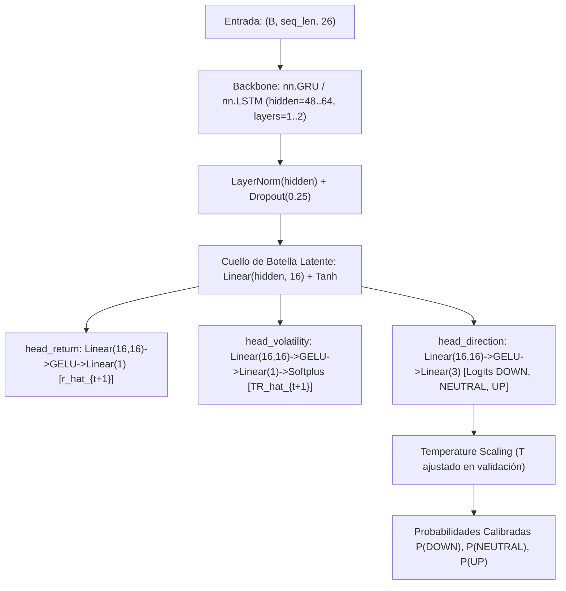

# Candle Predictor v2: Módulo Recurrente Multi-Cabezal (1h / 1d)

## 1. Resumen Ejecutivo
**Candle Predictor v2** es el motor neuronal recurrente multi-ticker diseñado para estimar la siguiente vela ($t+1$) en temporalidades **`1h` y `1d`** sobre el universo oficial de **30 tickers + `BTCUSDT`**.

Evoluciona el modelo univariado previo (`lstm_v1.pt`, `hidden_dim=32, seq_len=10`) hacia una arquitectura **multi-cabezal compacta (`NextCandleGRU`)**, eliminando el sobreajuste previo mediante:
1. **Representación 100% estacionaria y adimensional:** agnóstica al precio nominal (misma red para activos de \$20 o \$95,000).
2. **Validación Walk-Forward cronológica con embargo:** aislamiento estricto de ventanas entre símbolos (ninguna ventana cruza tickers).
3. **Calibración probabilística (Temperature Scaling) + abstención (HOLD):** filtrado de señales en velas de ruido.
4. **Extractor de estado latente ($h_t$) para Laya #1 (`Laya1DRLPolicyNet`):** puente continuo hacia el agente DRL sin romper el contrato actual de 10 dimensiones.

---

## 2. Integridad Cuantitativa y Reglas Anti-Overfitting

| Regla | Implementación en Código | Garantía |
| :--- | :--- | :--- |
| **Cero Look-Ahead Bias** | `CausalRobustScaler` (`center=median`, `scale=IQR`) | Ajustado exclusivamente sobre las velas $0 \dots t_{\text{train}}$ de cada fold. Prohibido `StandardScaler` global. |
| **Aislamiento Multi-Ticker** | `MultiTickerSequenceDataset` / `build_index` | Cada secuencia $(x_1 \dots x_{\text{seq\_len}})$ proviene íntegramente de un único `symbol`. Prohibido cruzar fronteras entre tickers. |
| **Walk-Forward con Embargo** | `make_walk_forward_splits` | $t_{\text{train\_label}} < \min(t_{\text{val\_window\_start}})$. `embargo_bars = seq_len` para purgar solapamiento de ventanas. Prohibido `shuffle=True`. |
| **Targets Estacionarios** | $r_{t+1} = \ln(C_{t+1} / C_t)$, $\text{TR}_{t+1} = (H_{t+1} - L_{t+1}) / C_t$ | Independiente de la escala del activo. Dirección de 3 clases (`DOWN`, `NEUTRAL`, `UP`) con umbral de costos ($\text{threshold}_{\text{bps}}$). |
| **Control de Complejidad** | $\text{seq\_len} \in [16, 48]$, $\text{hidden} \in [48, 64]$, capas $\in [1, 2]$ | Evita memorización de ruido intradía; latencia CPU $< 2.0\text{ ms}$. |

---

## 3. Pipeline Causal de Características (26 Dimensiones)

Todas las variables son causales y adimensionales calculadas al cierre de la vela $t$:

```text
Anatomía de vela:
  1. body_rel        = (Close - Open) / (High - Low + eps)
  2. upper_wick_rel  = (High - max(Open, Close)) / (High - Low + eps)
  3. lower_wick_rel  = (min(Open, Close) - Low) / (High - Low + eps)

Dinámica de retornos logarítmicos:
  4-9. logret_{1, 2, 3, 5, 10, 20} = ln(Close_t / Close_{t-k})

Volatilidad y rango:
  10-12. rv_{10, 20, 60} = std móvil de logret_1
  13. atr_pct            = ATR-14 Wilder / Close_t

Volumen relativo:
  14. log_rel_volume     = ln(clip(Volume / SMA20(Volume), 0.05, 20.0))
  15. has_volume         = 1.0 si SMA20(Volume) > 0, sino 0.0

Régimen y tendencia:
  16. dist_ema20         = (Close / EMA20) - 1.0
  17. dist_ema50         = (Close / EMA50) - 1.0
  18. ema20_slope        = clip(((EMA20_t / EMA20_{t-5}) - 1) / atr_pct, -10, 10)
  19. bb_width           = (4 * std20) / sma20
  20. rsi_01             = RSI-14 Wilder / 100.0

Ciclo temporal y sesión:
  21-22. hour_sin, hour_cos = sin, cos(2*pi * hour_utc / 24)
  23-24. dow_sin, dow_cos   = sin, cos(2*pi * day_of_week / 7)
  25. session_flag          = 1.0 (Cripto 24/7 o Equity en sesión 13-20 UTC)
  26. is_crypto             = 1.0 si activo cripto, sino 0.0
```

---

## 4. Arquitectura PyTorch (`NextCandleGRU`)



### Pérdida Multi-Tarea
$$\mathcal{L} = 1.0 \cdot \text{SmoothL1}\left(\frac{\hat{r}}{\sigma_r}, \frac{r}{\sigma_r}\right) + 0.5 \cdot \text{SmoothL1}\left(\frac{\widehat{\text{TR}}}{\mu_{\text{TR}}}, \frac{\text{TR}}{\mu_{\text{TR}}}\right) + 1.0 \cdot \text{CrossEntropy}(\text{logits}, y_{\text{dir}}, w_{\text{balanced}})$$

---

## 5. Adaptador de Estado para Laya #1 (`Laya1DRLPolicyNet`)

El agente Laya #1 mantiene retrocompatibilidad total con sus pesos actuales `laya1_drl_v1.pt` (`DRL_STATE_DIM = 10`), y a través de `extend_state_with_candle_v2` expone el vector extendido de **33 dimensiones**:

| Rango de Índices | Componente | Descripción |
| :--- | :--- | :--- |
| `[0 .. 9]` | **Estado Legacy (10)** | `pred_return_t1`, `ret_lag_1`, `ema_ratio`, `vol_20`, `rsi_14`, `momentum_5`, `position_open`, `signed_sqrt_r`, `sharpe_like`, `trend_sign` |
| `[10]` | **Alpha V2 Retorno** | $\text{clip}(\hat{r}_{\text{candle\_v2}} \cdot 50.0, -5.0, 5.0)$ |
| `[11]` | **Volatilidad Relativa** | $\text{clip}(\widehat{\text{TR}} / \max(\text{atr\_pct}, 10^{-4}), 0.0, 5.0)$ |
| `[12 .. 14]` | **Distribución Direccional** | Probabilidades calibradas: $P(\text{DOWN}), P(\text{NEUTRAL}), P(\text{UP})$ |
| `[15]` | **Edge Direccional** | $P(\text{UP}) - P(\text{DOWN})$ |
| `[16]` | **Bandera de Abstención** | $1.0$ si el modelo recomienda `HOLD`/baja confianza, $0.0$ si hay convicción activa |
| `[17 .. 32]` | **Embedding Latente ($h_t$)** | Vector de 16 dimensiones compactas en $[-1, 1]$ emitido por `encode_state()` |

---

## 6. Comandos de Entrenamiento y Evaluación

### Modo Piloto (5 Tickers: BTCUSDT, NVDA, SPY, AAPL, ETHUSDT)
```powershell
# Entrenamiento conjunto 1d y 1h
python -m backend.app.ml.candle_predictor.trainer --interval both --pilot --source auto

# Evaluación sobre holdout TE piloto
python -m backend.app.ml.candle_predictor.evaluator --interval 1d --tickers BTCUSDT,NVDA,SPY,AAPL,ETHUSDT --artifacts-dir notebooks/artifacts/pilot
python -m backend.app.ml.candle_predictor.evaluator --interval 1h --tickers BTCUSDT,NVDA,SPY,AAPL,ETHUSDT --artifacts-dir notebooks/artifacts/pilot
```

### Modo Universo Completo (30 Tickers + BTCUSDT)
```powershell
# Entrenamiento producción 1d (generando lstm_v2_1d.pt y candle_v2_manifest.json)
python -m backend.app.ml.candle_predictor.trainer --interval 1d --universe all --source auto

# Entrenamiento producción 1h
python -m backend.app.ml.candle_predictor.trainer --interval 1h --universe all --source auto --period 120d --epochs 25

# Evaluación OOS / TE sobre el universo oficial
python -m backend.app.ml.candle_predictor.evaluator --interval 1d --universe all
python -m backend.app.ml.candle_predictor.evaluator --interval 1h --universe all
```
